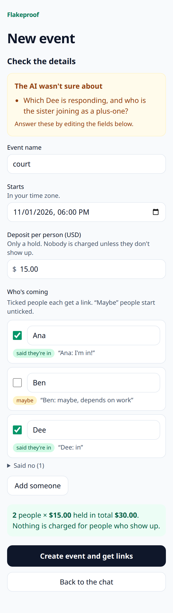
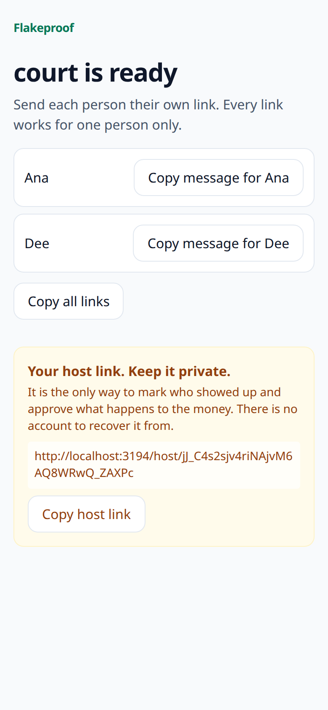
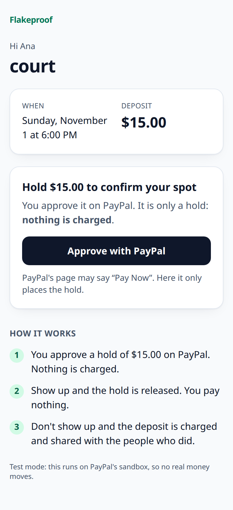
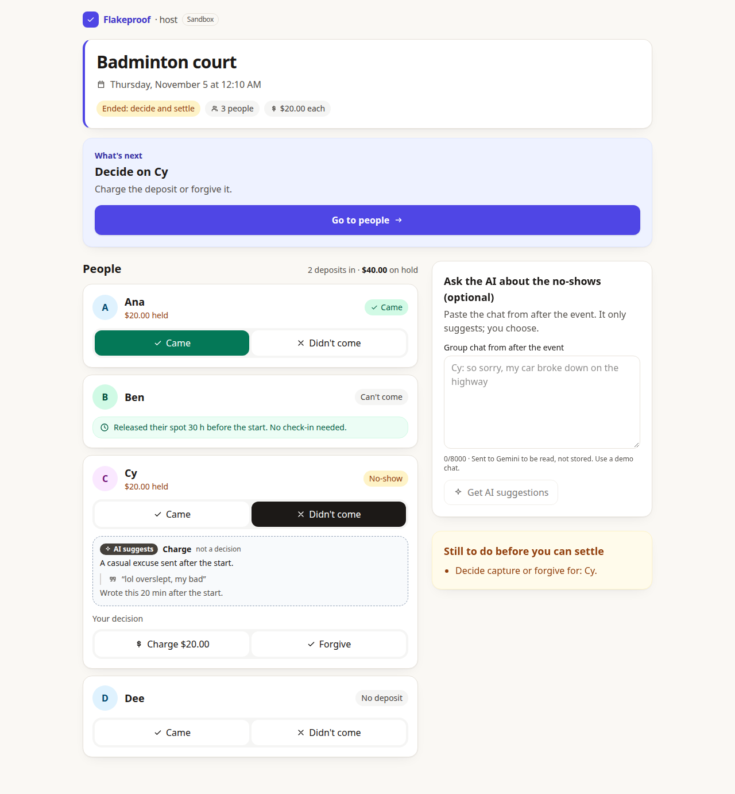
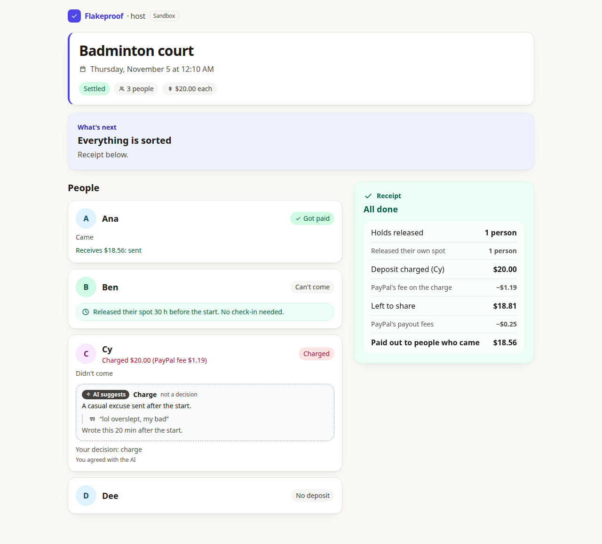

# Flakeproof

> A deposit that costs you nothing if you show up.

**Status (Oct 31): the whole story is built and has been run: chat to guest list, holds, check-in, AI
Judge, host approval, payout.** What has and has not been run against the real PayPal sandbox is labelled below.

<p>
  
  
  
</p>
<p>
  
  
</p>

*The first three screenshots are the real app on the real PayPal sandbox. The two host-dashboard screenshots are the real
server, web app and Gemini model, but with an in-memory PayPal stand-in so four buyer logins were not needed; the money flow
itself is checked on the real sandbox by `npm run e2e:sandbox`.*

## The idea

A host creates an event (a booked court, a restaurant table, tickets). Each friend opens one link, no
account, and approves a small deposit through PayPal. The deposit is only **authorized**: a hold,
nothing is charged.

After the event:

- Friends who showed up: their authorization is **voided**. They pay nothing.
- No-shows: their authorization is **captured**.
- The captured pot, after PayPal's fees, is **paid out** (PayPal Payouts) to the people who came.

Meant for events where a no-show costs the host real money, not casual hangouts. PayPal honors an
authorization for 3 days (valid 29; reauthorization is not built). The host may pick any start time,
but the app warns when it is further away than the honor period, because capture may then be refused.

## Before you start (about 15 minutes, one time)

You need three things. Without them you can still run `npm test` (no keys needed).

1. **Node 22 or newer.**
2. **PayPal sandbox** (free, [developer.paypal.com](https://developer.paypal.com)): a **United States**
   Business account with a *Merchant* REST app (Client ID and Secret), plus at least one **United States**
   Personal account to play a friend. Step by step in [docs/sandbox-setup.md](docs/sandbox-setup.md).
   Non-US accounts break the payout step (currency conversion), so please use US.
3. **A Gemini API key**, free, from [aistudio.google.com/apikey](https://aistudio.google.com/apikey). Without
   it the app still works; the host adds guests by hand and the AI features say so.

## Run it

```bash
cp .env.example .env     # fill in PAYPAL_CLIENT_ID, PAYPAL_CLIENT_SECRET, GEMINI_API_KEY
npm run setup            # install, generate the Prisma client, create the SQLite database
npm test                 # 252 tests (182 server, 70 web), no keys needed
npm run dev              # API on :3001, web app on http://localhost:5173
```

Then open http://localhost:5173/new, add the group chat as a few **screenshots** (or paste text), check the transcript, review what the AI found, and copy each
friend's link. Open a friend's link, press **Approve with PayPal**, and log in with a sandbox Personal
account in a private window; PayPal returns you to the same page, which confirms the hold.

Checks that talk to the **real** services (they print a report you can read):

```bash
npm run e2e:sandbox          # the whole server flow on the PayPal sandbox: 3 friends, 1 flakes, pot paid to the 2 who came
npm run ai:smoke -w server   # the real Gemini model on a sample chat (needs GEMINI_API_KEY)
npm run ai:eval -w server    # 15 adversarial cases against the real model, ~4 minutes (needs GEMINI_API_KEY)
npm run spike                # raw PayPal calls: authorize, capture, void, payout
```

Single process, the way a hosted demo would run: `npm run build`, then
`APP_BASE_URL=http://localhost:3001 npm start`. `APP_BASE_URL` must be the address people actually
open, because guest links and PayPal's return URLs are built from it. Behind a proxy also set `TRUST_PROXY=1`.

## How AI is used

| Role | What it does | Model / service | State |
|---|---|---|---|
| RSVP agent | Reads pasted group-chat text and proposes the guest list, deposit and start time. Asks when unsure. | Google Gemini API (`GEMINI_MODEL`, currently `gemini-3.5-flash-lite`) | Built and run live |
| Screenshot reader | Reads 1 to 8 phone screenshots of the chat into a transcript (who wrote what, when). The host checks and edits the transcript before anything is extracted from it. Overlapping screenshots are merged by plain code. | Google Gemini API (`GEMINI_VISION_MODEL`, currently `gemini-3.5-flash`, falling over to `gemini-3.5-flash-lite` when it is overloaded) | Built and run live ([notes](docs/screenshots.md)) |
| Judge | After the event, reads the chat and recommends capture, forgive or unclear for each no-show, quoting their own words. The host decides and approves before any money moves. | same model | Built and run live ([design](docs/judge-design.md)) |

The model only reads and recommends. It cannot move money. Amounts, splits and rounding are plain code in
integer cents. Because the real model sometimes invents guests, every name, amount and time it returns is
checked against the pasted chat in code first (see [docs/api.md](docs/api.md)).

## What works (honest table)

| Piece | State |
|---|---|
| PayPal: authorize, void, capture, payout to a second account | **Run on the real sandbox, all pass** ([results](docs/spike-results.md)) |
| Server: events, guests, deposits, state machine, host-approved settlement ([API](docs/api.md)) | Built. **Real sandbox end to end passes** (`npm run e2e:sandbox`); 106 server tests against a fake PayPal |
| Money safety: never capture a deposit nobody could receive; payout preview; fee reserve | Built and tested with fakes. The fee model behind the preview is from a few sandbox observations |
| Host dashboard: end the event, check-ins, AI suggestions, decisions, approve and settle, live holds and payout progress | Built; 18 component tests. **Driven in a real browser through the full story** (three came, one flaked, AI suggested, host charged, three paid) against the real server and real Gemini, with an in-memory PayPal. Not yet clicked through by a person on the real sandbox with four accounts |
| Guest link page (mobile first) | Built; 35 web tests. **Driven in a real headless browser at phone width**: renders, no console errors, and "Approve with PayPal" reaches PayPal's sandbox. The approval-and-return leg was not completed by automation |
| Screenshots in: add the chat from a phone, merged transcript, host edits it, amounts and days highlighted to check | Built; 43 server and 15 web tests. **Driven in a real headless browser at phone width against the real server and real Gemini** on a fabricated 52-message chat in 7 screenshots: 2 of 3 full runs gave an exact transcript and the correct final plan; the third hit the free-tier quota (the app shows "Try again" per screenshot). See [docs/screenshots.md](docs/screenshots.md) for what it gets wrong |
| RSVP agent: paste chat, verified proposal, host review, invite links | Built. Real Gemini checked live, including prompt-injection and invented-guest cases |
| AI Judge: verified recommendations, never pre-selected, with timing facts computed in code | Built. **Real Gemini evaluated on 15 adversarial cases, all passing on every run** ([results](docs/spike-results.md)): a real excuse gets forgive with a verified quote, a casual one gets charge, text addressed to the AI (even smuggled in as a fake `SYSTEM:` line) is flagged and left to the host |
| Tests with a fake PayPal and a fake AI | Done |

Paths that exist in code but were **never run against the real PayPal sandbox** (only fakes or a local stub):
reading a pending capture, `UNCLAIMED` / `ONHOLD` payout items, voiding a hold that did not match the deposit.

## Sandbox only

No live credentials and no real money, anywhere. The PayPal host is hardcoded to the sandbox. PayPal charges
fees even in the sandbox, so the pot is smaller than the sum of deposits (the host view shows both).
More in [docs/security-notes.md](docs/security-notes.md), including known limits and an `npm audit` note.

## Docs

[Sandbox setup](docs/sandbox-setup.md) · [API and AI guardrails](docs/api.md) · [Spike and live-check results](docs/spike-results.md) ·
[Judge design](docs/judge-design.md) · [Security notes](docs/security-notes.md) · [Demo runbook and schedule](docs/demo-runbook.md) · [Official Rules notes](docs/official-rules-notes.md)

## Rules and what is still unverified

The Official Rules were read on Oct 31 and are summarised, with our status against each, in
[docs/official-rules-notes.md](docs/official-rules-notes.md). Submission period ends **Nov 12, 2026, 12:00 pm PT**.
Not assessed: whether a service that pools friends' deposits could operate with real money (the Rules ask only for a
sandbox integration; this project is sandbox only).

## License

MIT, see [LICENSE](LICENSE).
