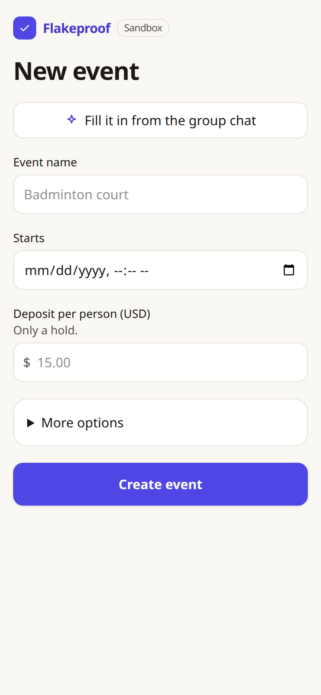
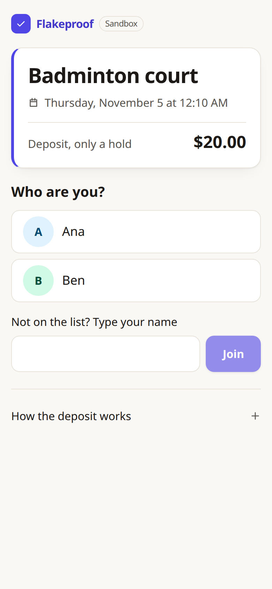
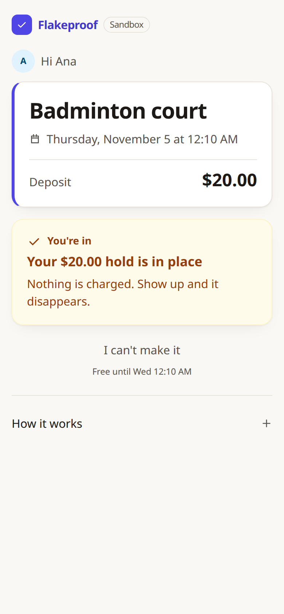
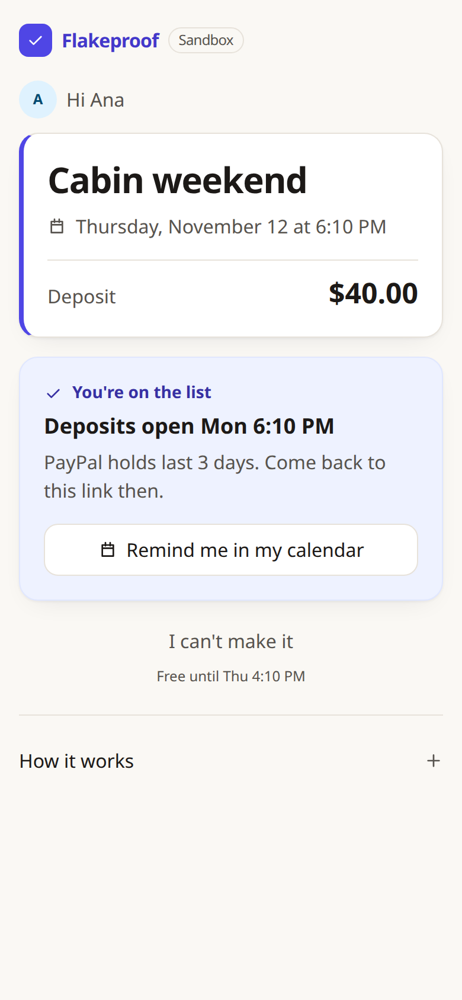
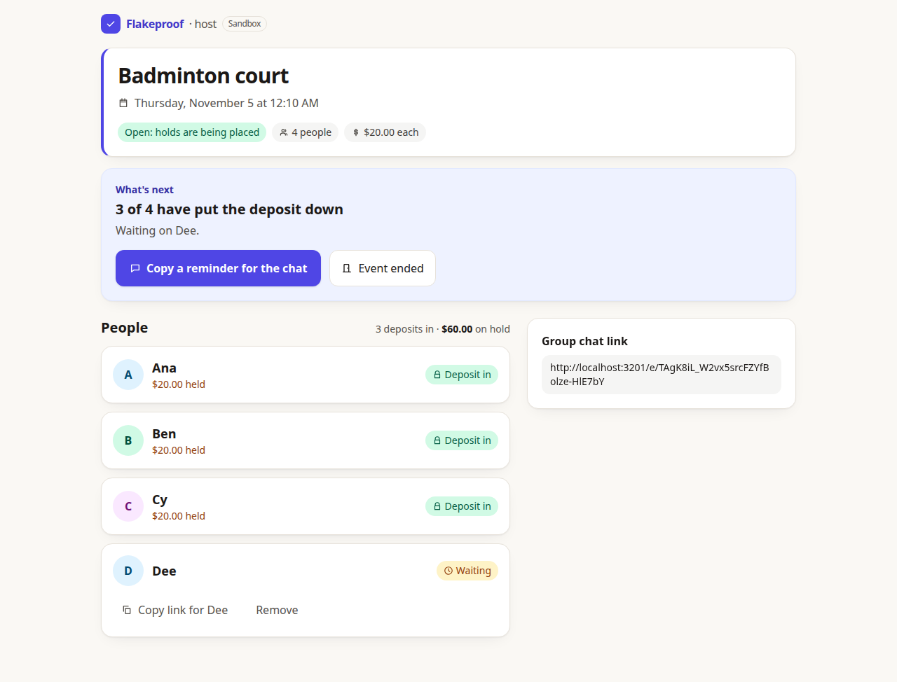

# Flakeproof

> A deposit that costs you nothing if you show up.

**Status (Nov 3): the whole story is built and has been run: one link in the group chat, friends tap their name, holds, check-in, AI
Judge, host approval, payout.** The first real four-account sandbox run is Nov 4. What has and has not been run against the real
PayPal sandbox is labelled below.

<p>
  
  
  
  
</p>
<p>
  
  
</p>
<p>
  
</p>

*These are the real server and web app with an **in-memory PayPal stand-in**, so no four buyer logins were needed; the money
flow itself is checked on the real sandbox by `npm run e2e:sandbox`, and the screens will be re-taken on the real sandbox after the
Nov 4 run. The AI suggestion text in the fourth screenshot was written into the database for the picture; the real AI path is
evaluated by `npm run ai:eval`.*

## The idea

A host books something (a court, a table, a cabin) and pastes **one link** into the group chat. Each friend opens it, taps their
name (or types it), no account, and puts down a small deposit through PayPal. The deposit is only **authorized**: a hold, nothing is charged.

After the event:

- Friends who showed up: their authorization is **voided**. They pay nothing.
- No-shows: their authorization is **captured**.
- The captured money, after PayPal's fees, is either **paid out** (PayPal Payouts) to the people who came (default), or **kept by the
  host** to cover the booking. The host chooses when creating the event.

### Built for how friend groups actually behave
We re-checked every feature against what normally happens in a friend group and changed what did not fit
([the review](docs/feature-research.md)):

| What really happens | What Flakeproof does |
|---|---|
| The host pastes one link into the chat; nobody DMs eight people one by one | **One shared link.** Friends tap their name; each gets their own page, remembered on their phone |
| The host types "Sat 5pm, court, $15" more often than they screenshot a chat | A plain **form is step 1**; reading a group chat with AI is an optional shortcut |
| Plans are made a week ahead, but PayPal honors a hold for 3 days | Friends join any time; **deposits open 3 days before** the start, with a calendar reminder and a ready-made reminder message for the chat |
| People cancel in the chat, and hosts need notice to rebook | A friend can **release their own deposit** until a cutoff the host picks (default 1 day before); later, it only warns the host |
| Most people show up | **"Everyone came"**, then fix the exceptions |
| A host who paid for the court wants the court paid for | The host chooses **share with those who came** or **keep it** |
| People join late or never put money down | Deposits close at the start time; the host sees "No deposit" plainly. Nothing can be charged without a hold, and the app says so |

Meant for events where a no-show costs the host real money, not casual hangouts. PayPal honors an authorization for 3 days
(valid 29); reauthorization is not built, which is why deposits open 3 days before the start instead.

**Known limit:** every friend needs a PayPal account or PayPal's card checkout, and the sandbox flow is United States only.

## Before you start (about 15 minutes, one time)

You need three things. Without them you can still run `npm test` (no keys needed).

1. **Node 22 or newer.**
2. **PayPal sandbox** (free, [developer.paypal.com](https://developer.paypal.com)): a **United States**
   Business account with a *Merchant* REST app (Client ID and Secret), plus at least one **United States**
   Personal account to play a friend. Step by step in [docs/sandbox-setup.md](docs/sandbox-setup.md).
   Non-US accounts break the payout step (currency conversion), so please use US.
3. **A Gemini API key**, free, from [aistudio.google.com/apikey](https://aistudio.google.com/apikey). Without
   it the app still works; the host adds guests by hand and the AI features say so.

## Run it

```bash
cp .env.example .env     # fill in PAYPAL_CLIENT_ID, PAYPAL_CLIENT_SECRET, GEMINI_API_KEY
npm run setup            # install, generate the Prisma client, create the SQLite database
npm test                 # 323 tests (200 server, 123 web), no keys needed
npm run dev              # API on :3001, web app on http://localhost:5173
```

Then open http://localhost:5173/new, fill in the event (or press **Fill it in from the group chat** to let the AI read screenshots or pasted text),
and copy the message with the one link. Open that link in a private window, tap or type a name, press **Approve with PayPal**, and log in with a
sandbox Personal account; PayPal returns you to the friend's page, which confirms the hold. Use a different private window per friend.

Checks that talk to the **real** services (they print a report you can read):

```bash
npm run e2e:sandbox          # the whole server flow on the PayPal sandbox: 3 friends, 1 flakes, pot paid to the 2 who came
npm run ai:smoke -w server   # the real Gemini model on a sample chat (needs GEMINI_API_KEY)
npm run ai:eval -w server    # 15 adversarial cases against the real model, ~4 minutes (needs GEMINI_API_KEY)
npm run spike                # raw PayPal calls: authorize, capture, void, payout
```

Single process, the way a hosted demo would run: `npm run build`, then
`APP_BASE_URL=http://localhost:3001 npm start`. `APP_BASE_URL` must be the address people actually
open, because guest links and PayPal's return URLs are built from it. Behind a proxy also set `TRUST_PROXY=1`.

## How AI is used

| Role | What it does | Model / service | State |
|---|---|---|---|
| RSVP agent | Reads pasted group-chat text and proposes the guest list, deposit and start time. Asks when unsure. | Google Gemini API (`GEMINI_MODEL`, currently `gemini-3.5-flash-lite`) | Built and run live |
| Screenshot reader | Reads 1 to 8 phone screenshots of the chat into a transcript (who wrote what, when). The host checks and edits the transcript before anything is extracted from it. Overlapping screenshots are merged by plain code. | Google Gemini API (`GEMINI_VISION_MODEL`, currently `gemini-3.5-flash`, falling over to `gemini-3.5-flash-lite` when it is overloaded) | Built and run live ([notes](docs/screenshots.md)) |
| Judge | After the event, reads the chat and recommends capture, forgive or unclear for each no-show, quoting their own words. The host decides and approves before any money moves. | same model | Built and run live ([design](docs/judge-design.md)) |

The model only reads and recommends. It cannot move money. Amounts, splits and rounding are plain code in
integer cents. Because the real model sometimes invents guests, every name, amount and time it returns is
checked against the pasted chat in code first (see [docs/api.md](docs/api.md)).

## What works (honest table)

| Piece | State |
|---|---|
| PayPal: authorize, void, capture, payout to a second account | **Run on the real sandbox, all pass** ([results](docs/spike-results.md)) |
| Server: events, guests, deposits, state machine, host-approved settlement ([API](docs/api.md)) | Built. **Real sandbox end to end passes** (`npm run e2e:sandbox`, run before the Nov 3 changes; re-run Nov 4); 200 server tests against a fake PayPal |
| One shared link: friends tap a listed name or type their own, get a personal link | Built; server and page tests (claim once, duplicate names, full event, rate limit, host can remove a name before it has a hold). **Driven in a real headless browser** with an in-memory PayPal. Not yet tried by real friends |
| Deposits open 3 days before the start and close at the start; calendar reminder | Built and tested with a controllable clock. The `.ics` content is unit-tested; opening it in a real calendar app was **not** tried |
| "I can't make it": a friend releases their own hold before a host-chosen cutoff | Built; server and page tests. The PayPal void it triggers is the same call settlement uses (real-sandbox proven), but the early-release path itself has **not** been run on the real sandbox yet (Nov 4) |
| Host chooses where a no-show's money goes: share with those who came, or keep it | Built and tested. "Keep" has **not** been run on the real sandbox (capture is the same call; nothing is paid out) |
| "Everyone came" and remove-a-name | Built and tested |
| Money safety: never capture a deposit nobody could receive; payout preview; fee reserve | Built and tested with fakes. The fee model behind the preview is from a few sandbox observations |
| Host page: what's next, people, check-ins, AI suggestions, decisions, approve and settle, receipt, live holds and payout progress | Built; component tests. **Driven in a real browser through the story** (one released early, one flaked, AI suggestion shown, host charged, one paid) against the real server with an in-memory PayPal. Not yet clicked through by a person on the real sandbox with four accounts |
| Friend page (mobile first) | Built; component tests. **Driven in a real headless browser at phone width**: renders, no console errors, and "Approve with PayPal" reached PayPal's sandbox in an earlier version. The approval-and-return leg was not completed by automation |
| Screenshots in: add the chat from a phone, merged transcript, host edits it, amounts and days highlighted to check | Built; 43 server and 15 web tests. **Driven in a real headless browser at phone width against the real server and real Gemini** on a fabricated 52-message chat in 7 screenshots: 2 of 3 full runs gave an exact transcript and the correct final plan; the third hit the free-tier quota (the app shows "Try again" per screenshot). See [docs/screenshots.md](docs/screenshots.md) for what it gets wrong |
| RSVP agent: paste chat, verified proposal, host review | Built, now an optional shortcut on the new-event form. Real Gemini checked live, including prompt-injection and invented-guest cases |
| AI Judge: verified recommendations, never pre-selected, with timing facts computed in code | Built. **Real Gemini evaluated on 15 adversarial cases, all passing on every run** ([results](docs/spike-results.md)): a real excuse gets forgive with a verified quote, a casual one gets charge, text addressed to the AI (even smuggled in as a fake `SYSTEM:` line) is flagged and left to the host |
| Tests with a fake PayPal and a fake AI | Done |

Paths that exist in code but were **never run against the real PayPal sandbox** (only fakes or a local stub):
reading a pending capture, `UNCLAIMED` / `ONHOLD` payout items, voiding a hold that did not match the deposit.

## Sandbox only

No live credentials and no real money, anywhere. The PayPal host is hardcoded to the sandbox. PayPal charges
fees even in the sandbox, so the pot is smaller than the sum of deposits (the host view shows both).
More in [docs/security-notes.md](docs/security-notes.md), including known limits and an `npm audit` note.

## Docs

[Sandbox setup](docs/sandbox-setup.md) · [API and AI guardrails](docs/api.md) · [Spike and live-check results](docs/spike-results.md) ·
[Judge design](docs/judge-design.md) · [Security notes](docs/security-notes.md) · [Demo runbook and schedule](docs/demo-runbook.md) · [Official Rules notes](docs/official-rules-notes.md) · [Feature research](docs/feature-research.md)

## Rules and what is still unverified

The Official Rules were read on Oct 31 and are summarised, with our status against each, in
[docs/official-rules-notes.md](docs/official-rules-notes.md). Submission period ends **Nov 12, 2026, 12:00 pm PT**.
Not assessed: whether a service that pools friends' deposits could operate with real money (the Rules ask only for a
sandbox integration; this project is sandbox only).

## License

MIT, see [LICENSE](LICENSE).
