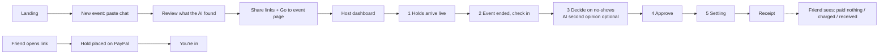

# Flakeproof: UI spec v2 (Nov 3, supersedes the money lane and stepper below)

**Why v2.** The first redesign still looked like a fintech dashboard: slate and black, tiny uppercase labels, a "money lane" and a
five-step stepper that only make sense once you already know the product. A friend opening a link from a group chat expects
an *invitation* (Partiful, Evite, Luma, Apple Invites), not a payments console. v2 keeps the honest copy and every state, and
changes the look and the structure to what people already know. Nov 3 evening: emoji removed and radii calmed so it reads
professional without turning back into a dashboard.

## What normally happens in a friend group (and what we changed because of it)
| Reality | Old design | v2 |
|---|---|---|
| The host pastes **one link into the group chat**; nobody DMs 8 people one by one | One personal link per friend, host copies each | **One shared link** `/e/:code`. Friends tap their name (or type it) and get their own page. Personal links still exist as the capability, remembered on the phone |
| The host types "Sat 5pm, court, $15" rather than screenshotting 50 messages | Chat reading was step 1 | **A plain form is step 1.** "Fill it in from the group chat (AI)" is an optional shortcut at the top |
| Plans are made a week ahead; PayPal honors a hold 3 days | A warning only | Friends join any time; **holds open 3 days before** (calendar reminder download, plus a ready "holds are open" message for the chat) |
| People cancel in the chat, not in an app, and hosts want 24 h notice for a booking | Fixed 2 h cutoff | **The host picks the free-cancellation cutoff** (default 24 h) |
| Most people show up; tapping everyone is tedious | Tap Came for each | **"Everyone came"**, then fix the exceptions |
| A host who paid for the court wants the court paid for, not a $6 split | Pot always shared | **Host chooses**: share with the people who came (default) or keep it |
| Hosts forget to press "end" and settle | Several steps | One **"What's next"** card on top, with the real button in it |
| Friends join late in the game | Could still start a hold after the start | **Holds close at the start time** |

## Look
- Warm paper background, one brand colour (indigo) for actions, three status colours used only for meaning:
  green = in / free / came, amber = waiting / reserved, rose = charged. No PayPal blue (we are not PayPal).
- Big friendly type (title 30/34, body 17), 16-20 px radius, generous spacing, one primary button per screen, 52 px tall.
- An **event header** on a calm white card with one indigo accent edge: the name, then when. **No emoji anywhere** (a test enforces it);
  icons are small inline SVGs, and every status is a word.
- **People are avatars** (initials on a soft colour) with a plain word beside them: "In", "Waiting", "Can't come", "Came",
  "Didn't come". Money words appear only where money moves.
- Removed: the money lane, the stepper, the uppercase micro-labels.

## Words
**Few of them.** One idea per screen. Explanations live behind a tap (`How it works`, `How the deposit works`), the sandbox note is a
small "Sandbox" tag beside the logo instead of a sentence on every page, and a line is only shown if the status chip cannot say it.
A test (`web/test/copyBudget.test.tsx`) caps the visible words per screen (landing 75, join 35, friend about to pay 50, host 60).
Say "deposit" and "hold" (people know it from hotels and fuel pumps) and explain once: "PayPal sets aside $20. Nothing is charged
if you come." Avoid capture / void / authorize / settle in the UI. Buttons: "Put down the deposit", "I can't make it",
"Everyone came", "Charge $20" / "Forgive", "Pay out and finish".

## Screens
1. **Landing**: promise, one button, four plain steps with small icons, the sandbox note. Recent events on this device.
2. **New event**: *What* (name), *When*, *Deposit*, then "More options" (free cancellation, where a flake's money goes, names
   to pre-list). Shortcut card: "Have the plan in a chat? Let the AI fill this in."
3. **Share**: ONE link with "Copy message for the group chat" (text already written) and the system share sheet; the host link is
   a separate, clearly private card; "Open event page".
4. **Join** `/e/:code` (what friends see first): the invitation, "Who are you?" as name chips (listed names) plus "Someone else",
   a count of people already in. Coming back on the same phone goes straight to the friend's own page.
5. **Friend page**: invitation header, one status card, one primary button. States: not joined yet is the join page; holds not
   open yet (date, calendar reminder); ready to put the deposit down; in; can't make it (confirm); released; event over (free /
   charged / received); closed.
6. **Host page**: header, **What's next** card (the real button), the people list, money in one line, then the AI and
   approval cards. Desktop is two columns; the next card stays on top.

## Accessibility (kept)
Every status is a word, not only a colour; 44 px targets; visible focus; headings per screen; polite live region for changes; reduced motion
removes the one check animation; contrast checked on the three status pairs.

---

# Flakeproof: UX audit and redesign spec

Design is one fifth of the hackathon score ("a complete, coherent product experience, not just a technical proof
of concept"), and the 3-minute video must show the product working end to end. This is a **spec only**, written
from the screens as they exist on Oct 31 (real browser, 390 px wide) for the next frontend pass. Existing stack is
kept: React 19, Tailwind 4 tokens in `web/src/index.css`, no UI library, inline SVG icons, no third-party logos.

## 1. Context

**People**
- **Host** (organizes, pays for the booking). Uses a phone before and during the event, a laptop afterwards. Wants to
  stop chasing people for money and never wants to be the bad guy. Acts rarely but the actions are high stakes.
- **Friend** (guest). Opens one link on a phone from a chat, once, in under a minute. Must understand in one glance that
  nothing is charged unless they don't show up. Has no account and should not need one.
- **Judge** (indirect). Watches 3 minutes of video, may try the repo. Sees the landing page first if they run it.

**Jobs**
1. Host: turn a chat into an event with links (high frequency, low stakes).
2. Friend: place a hold with confidence (once, trust is the whole job).
3. Host: check people in, decide on no-shows, approve the money (rare, high stakes, must feel safe).
4. Everyone: see what happened to the money, honestly.

**Success measures (for usability checks)**: a stranger can say what Flakeproof does in 5 seconds from the landing page;
a friend can say "it's a hold, not a charge" without scrolling; a host completes approve-and-settle without asking what
a button does; nobody ever believes the AI made a decision.

## 2. Audit: what is wrong today

Ranked by effect on the score and on trust. Evidence is from the real-browser screenshots in `docs/screenshots/`.

### Blockers for "complete product"
1. **No visual identity.** Every screen is white cards, a green wordmark and slate buttons. Nothing shows the idea (a hold that
   turns into "released" or "charged", money flowing to the people who came). It reads as a prototype. *Fix: one signature
   element, the money lane (section 4), used on every screen.*
2. **Landing page is a dead end.** A headline, one sentence, one button, and 70% empty screen. A judge who runs the app
   learns nothing and sees nothing. *Fix: section 5.1.*
3. **Created screen has no way forward.** After "Create event" the host sees copy buttons and a host link in a warning box
   but **no button to open the event page**. They must copy a URL and paste it. This breaks the story at its most visible moment.
   *Fix: primary button "Go to your event page".*
4. **The host dashboard does not tell you what to do next.** The page is one long scroll (friends, AI panel, estimate, blockers,
   approve card). The approve card is at the very bottom; there is no sense of progress. A first-time host must read everything.
   *Fix: stepper plus a sticky next-action bar (section 5.4).*

### Major
5. **Check-in buttons are unscannable.** "Came / Didn't come" are two identical outlines when nothing is chosen, so a row of
   four friends is four identical rows. *Fix: segmented control with a leading icon, a count summary ("2 came, 1 didn't, 1 not marked"),
   and "unmarked" visibly different from "marked".*
6. **The AI suggestion sits too close to the decision buttons.** It is clearly labelled, but "Charge" in bold directly above a
   "Charge $20.00" button can read as pre-selected, which is exactly the thing the product promises it never does.
   *Fix: a distinct "second opinion" panel (dashed border, neutral slate, never the colours used for a selected choice),
   always above and visually separated from the host's own choice, plus an "overruled the AI" / "agreed with the AI" audit tag after.*
7. **Money is scattered through sentences.** Hold, charge, fee, share and total appear as prose in different cards. The settled
   screen, the payoff of the video, is a paragraph. *Fix: a receipt component (section 4.3) with tabular numerals.*
8. **No confirmation moment for the friend.** After approving on PayPal the friend lands on a page that quietly changes. The
   most emotional beat (you're in) has no feedback beyond text. *Fix: a short check animation (respects reduced motion) and a
   clear "You're in" state.*
9. **Desktop is a phone in the middle of a wide empty page.** Fine for friends, poor for the host who will use a laptop and for
   the video if recorded on desktop. *Fix: two-column host dashboard from 1024 px.*
10. **Terminology drifts.** hold / deposit / hold in place / charge / capture, "Event ended" vs "close deposits",
    "Didn't come" vs "no-show". *Fix: the glossary in 4.4, used everywhere.*

### Minor
11. Loading is plain text; use skeletons. 12. Polling failures are silent while the event is open. 13. `document.title` is always
"Flakeproof"; set it per screen and move focus to the new heading when a step changes. 14. The new-event page has no step indicator
and its questions are in one box away from the fields they are about. 15. No skip link.

### What is already good (do not break)
Plain honest copy ("It is only a hold: nothing is charged"); every state of the guest page; two-step confirmation for ending the
event; the explicit approval tick; the AI's evidence quote and the timing fact; large tap targets; visible focus; reduced-motion CSS;
`aria-pressed` on toggles; the "Said no" tuck-away; the no-pre-selection rule.

## 3. Flow



Failure and edge paths that need a designed state: AI unavailable (skip to manual), PayPal declined/cancelled, host link lost
(recent events on the landing page), capture refused, a payout item that needs attention, nobody who came can be paid
(charging is blocked with a reason), event beyond the 3-day honor period (warning).

## 4. System

### 4.1 Signature element: the money lane
A compact horizontal track that shows where one person's deposit is. Four nodes, left to right:

```
 Hold ──●── Event ──○── Outcome ──○── Paid
```
- Node states: `todo` (hollow, neutral), `now` (filled, ring), `done` (filled, check).
- The **Outcome** node takes the outcome colour and label: `Released` (green), `Charged` (rose), `Pending` (amber).
- **Paid** appears only for people who receive a share, with the amount.
- Used on: each friend row of the host dashboard (small), the guest page (large, the hero), the receipt (final).
- Never uses colour alone: every node has a text label and the state is in the accessible name
  ("Ana: hold in place, event not finished").

### 4.2 Components (existing, changed, new)
| Component | Status | Notes |
|---|---|---|
| `Button` (primary / secondary / quiet / danger-quiet) | **new, extract** | Today the class strings are copied in 3 files. One component, min height 48 px primary, 44 px other |
| `SegmentedControl` | **new** | For check-in (Came / Didn't come) and decision (Charge / Forgive). `role="group"` + buttons with `aria-pressed`; icon + text; selected uses a **solid** tone, unselected stays neutral |
| `MoneyLane` | **new** | Section 4.1 |
| `Stepper` | **new** | Host dashboard and new-event; current step has `aria-current="step"` |
| `StickyActionBar` | **new** | Mobile: pinned bottom bar with the one next action and a one-line why; desktop: sits in the right column |
| `Receipt` | **new** | Section 4.3 |
| `AiNote` | **changed** from the inline suggestion box | Dashed border, slate, label "AI suggestion, not a decision", quote as `<blockquote>` with "Cy wrote", timing chip, flag callout |
| `StatusChip` | changed | Add icon; colours from status tokens |
| `Card`, `Banner` | keep, move to shared `ui/` | |
| `Skeleton` | **new** | Replaces "Loading…" text |
| `CopyButton` | **new** | Copies, then shows "Copied" for 2 s via `aria-live` |
| `ShareButton` | **new** | `navigator.share` when available, else copy |
| `Icon` | **new** | Inline SVG: check, clock, lock, copy, share, arrow-right, alert, quote, users. No icon library |

### 4.3 Receipt (the video's payoff screen)
Right-aligned tabular numbers; one line per fact; the last line is the one that matters.

```
 Court booking         Settled
 ─────────────────────────────────────────
 Holds released                   3 people
 Deposit charged (Cy)               $20.00
 PayPal's fee on that charge        −$1.19
 Left to share                      $18.81
 PayPal's payout fees (3 × $0.25)   −$0.75
 Paid out                           $18.06
   Ana  $6.02 ✓   Ben  $6.02 ✓   Dee  $6.02 ✓
```
Every figure comes from existing API fields (see section 9). While settling, unconfirmed payout rows show a spinner and
"sending"; the receipt is only labelled "Settled" when every payout item is `SUCCESS`.

### 4.4 Glossary (one name per idea, everywhere)
| Say | Never say | Meaning |
|---|---|---|
| **Hold** | deposit hold, authorization | Money PayPal sets aside. Not charged |
| **Release** | void, cancel | A hold goes away; the person pays nothing |
| **Charge** | capture | A hold becomes a real payment |
| **Payout** | transfer | Sending someone their share |
| **Came / Didn't come** | showed / no-show (in UI) | Attendance |
| **Forgive** | waive | Choose to release a no-show's hold |
| **AI suggestion** | recommendation, verdict, decision | Advice only |
| **Your decision** | | What the host chose |

### 4.5 Tokens (add to `@theme` in `web/src/index.css`; keep existing `good-*`, `hold-*`, `charged-*`, `ink-*`)
```
/* surfaces */   --color-surface:#ffffff   --color-surface-sunken:#f1f5f9   --color-paper:#f8fafc (existing)
/* status */     --color-status-held:#92400e  (text) / #fef3c7 (bg)        amber  = hold in place
                 --color-status-released:#065f46 / #d1fae5                  green  = released, paid
                 --color-status-charged:#9f1239 / #ffe4e6                   rose   = charged
                 --color-status-info:#334155 / #e2e8f0                      slate  = AI, neutral facts
/* AI */         --color-ai-border:#94a3b8 (used dashed)   --color-ai-bg:#f8fafc
/* radius */     control 12px, card 20px, chip 999px
/* elevation */  elev-1: 0 1px 2px rgb(15 23 42/.05), 0 8px 24px -12px rgb(15 23 42/.12) (existing --shadow-card)
                 elev-2: 0 -8px 24px -12px rgb(15 23 42/.18)   (sticky bar)
/* type */       display 32/36 700 · title 20/28 600 · body 16/24 · caption 13/18 · money: tabular-nums, 600
/* space */      4-pt scale; card padding 20 (mobile 16); section gap 24
/* motion */     fast 120ms, base 240ms; ease-out; all disabled under prefers-reduced-motion (already global)
/* hit area */   min 44×44 (primary 48)
```
Contrast: all text/background pairs above are ≥ 4.5:1 (checked against the existing palette; re-run an automated check, see 7).
The AI panel must never use `good-*` or `charged-*` fills, because those mean "selected decision".

## 5. Screens

### 5.1 Landing
**Goal**: in 5 seconds, say what it is, why it's safe, and what to do.
```
┌────────────────────────────┐
│ Flakeproof                 │
│                            │
│ A deposit that costs you   │
│ nothing if you show up.    │
│ Book the court. Friends    │
│ hold $15. Flakers pay;     │
│ the people who came split  │
│ it.                        │
│ [ Host an event ]          │
│ Have an invite? Open the   │
│ link your host sent you.   │
│                            │
│ How it works               │
│ 1 ◔ Friends place a hold   │
│    PayPal sets money aside │
│    Nothing is charged.     │
│ 2 ✓ You come: it's released│
│ 3 $ You don't: it's charged│
│    and shared with the     │
│    people who came.        │
│ [sample money lane graphic]│
│ Events you created here    │
│ · Court booking   Nov 7  › │
│ Test mode: PayPal sandbox. │
└────────────────────────────┘
```
- States: first visit (no recent events); returning (list of recent events, newest first, with status chip, e.g. "Settled").
- Desktop: two columns, copy left, an illustrative static money lane and the receipt right.
- Content: no marketing claims we cannot back. No statistics about no-shows unless sourced.
- Data: none new (recent events are client-side).

### 5.2 New event (3 steps: Paste, Review, Share)
- **Stepper** at the top (1 Paste · 2 Review · 3 Share). Focus moves to the step heading on change; `document.title` follows.
- **Paste**: keep the textarea and the privacy line, but move the privacy text into a small "What happens to this text?" disclosure
  that also says "Sent to Google's Gemini API, not stored by Flakeproof. Use a demo chat." Primary "Read the chat" with a determinate-looking
  progress state ("Reading… usually 2 seconds"); secondary "I'll add people myself". Show an example chat as a one-tap "Try an example"
  (helps judges and the video).
- **Review**: show the AI's questions **next to the field they concern** (deposit question under the deposit field, "who is Dee's
  sister?" under the guest list), not in one box. Keep the evidence quote and "only mentioned" badge. Add a live **summary bar**
  (sticky on mobile): "2 people × $15.00 = $30.00 held" with "Create event" as its button.
- **Share** (replaces "is ready"): 1. big **Go to your event page** button; 2. **Share invites** (`ShareButton`, one message per
  person); each friend row shows a live chip ("Waiting", then "Hold in place" as it happens: poll the host event); 3. host link
  card ("Keep this private") with Copy. Honest line: "This browser will remember it, but save it somewhere safe."
- States: AI unavailable (inline banner, "add people yourself" stays enabled), validation errors summarised at top with `role="alert"`
  and a link to each field, event far in the future (honor-period banner).
- Data: `POST /api/events` already returns `hostUrl` and guest `inviteUrl`s. **New (optional)**: `hostName` (the chat's organizer)
  so friends see who invited them.

### 5.3 Friend invite page (the trust screen)
**Goal**: understand and approve in under a minute.
```
┌────────────────────────────┐
│ Flakeproof                 │
│ Sam invited you            │  ← needs hostName (optional)
│ Court booking              │
│ Sat 7 Nov · 6:00 PM        │
│                            │
│  Your deposit      $15.00  │
│  ┌ money lane ───────────┐ │
│  │ Hold ─●─ Event ─○─ Result│
│  └────────────────────────┘│
│  🔒 PayPal holds it. Nothing │
│  is charged now.           │
│  [ Approve with PayPal ]   │
│  PayPal's page says        │
│  "Complete Purchase". Here │
│  it only places the hold.  │
│                            │
│ If you come: released, you │
│ pay nothing.               │
│ If you don't: $15 is       │
│ charged and shared with    │
│ the people who came.       │
│ Can't make it? Tell Sam    │
│ before; he decides.        │
└────────────────────────────┘
```
- **States** (existing set, plus visual): no hold; waiting for PayPal return (spinner, "Confirming with PayPal"); **You're in** (check
  animation, the lane at "Event"); event over, released ("You paid nothing", lane complete green); charged (rose, with Sam's name:
  "Talk to Sam if that's a mistake"); share received (amount, "On its way" → "Sent"); share problem ("Sam will sort it out"); deposits
  closed; invalid link.
- "Can't make it? Tell Sam before; he decides" is an honest expectation: it does **not** promise a refund.
- Accessibility: the lane has an accessible name describing the state; the approve button is the only primary action; the explanation
  is real text, not an image.
- Data: existing guest view; **new optional** `event.hostName`.

### 5.4 Host dashboard
Organised by **phase**, with the next action always visible.

**Header**: title, when, deposit each, phase chip. Under it a **Stepper**: `1 Holds · 2 Check in · 3 Decide · 4 Approve · 5 Done`.

**Mobile layout (single column)**
```
 Header + Stepper
 ┌ Next ───────────────────────┐   ← StickyActionBar (bottom), content changes by phase
 │ 3 of 4 holds in             │
 └─────────────────────────────┘
 Money summary strip:  Held $60 · Released – · Charged –
 Friends (cards, each with MoneyLane + SegmentedControl)
 AI second opinion (only phase 3, only if there are no-shows with holds)
 Payout estimate (only if something is being charged)
 Approve card (phase 4)
 Receipt (phase 5)
```
**Desktop (≥ 1024 px): two columns.** Left: friends. Right (sticky): next action, money summary, AI panel, estimate, approve, receipt.

**Sticky action bar content by phase**
| Phase | Bar text | Button |
|---|---|---|
| Holds, event open | "2 of 4 holds in" | Event ended (opens two-step confirm) |
| Check in, someone unmarked | "Mark who came: Ana, Ben" | disabled, shows what is missing |
| Decide, someone undecided | "Decide on Cy" | Ask the AI (optional) / scrolls to Cy |
| Approve, ready | "Release 3 · Charge 1 · Pay 3" | **Approve and settle** (opens the confirm sheet) |
| Settling | "Sending payouts… 2 of 3 done" | none (progress) |
| Done | "All paid" | View receipt |

**Friend card** (host view): name; `MoneyLane`; deposit line in plain words; check-in `SegmentedControl` (until settlement is approved);
for a no-show with a hold: the **AI second opinion** (if any) and, below it, the host's own `SegmentedControl` "Charge $20.00 · Forgive" with the
helper "Your decision. Nothing is chosen until you choose." After a decision: a tag "You overruled the AI" / "You agreed with the AI" / (none if no AI).

**AiNote** (never looks like a choice)
```
┌ ┄┄┄┄┄┄┄┄┄┄┄┄┄┄┄┄┄┄┄┄┄┄┄┄┄┄┄ ┐  dashed slate border
 AI suggestion · not a decision
 Charge
 "Cy gave a casual excuse after the start."
 Cy wrote: “lol overslept, my bad”
 [ 20 min after the start ]  [ later than your 2 h rule ]
└ ┄┄┄┄┄┄┄┄┄┄┄┄┄┄┄┄┄┄┄┄┄┄┄┄┄┄┄ ┘
```
A flagged message adds a callout: "This message is addressed to the AI. Treat it with care." An "AI wasn't sure" state shows no
colour at all.

**Approve** is a confirm sheet (modal on desktop, bottom sheet on mobile) that restates the money in a mini receipt (what will be
released, charged, paid, estimated payout) with the explicit tick "I approve this. I understand it cannot be undone." Focus is trapped
in the sheet; Escape cancels; the primary button is the last tab stop.

**Settling**: the sheet closes into the receipt in "in progress" mode: per-person payout rows with a spinner until `SUCCESS`; if PayPal
reports a bad status, the row shows "Needs attention" with plain help. After ~3 minutes without completion show "Check again".

**States**: loading (skeleton header + 3 skeleton cards); live-updates paused (small chip "Reconnecting…" instead of silent failure);
error banner; bad host link; blocked charge (reason in the bar and in the estimate); problems from the server rendered as alerts;
settled; lost host link (see landing).

**Data needs**: all present in `HostView` today. Additions: `payout.leftoverCents` (= pot − sum of item amounts − actual payout fees,
what stays with the host), `event.hostName`. The client derives counts (came / didn't / unmarked) itself.

## 6. Interactions and rules
- Nothing destructive is a single tap: ending the event (two-step), approving (sheet + tick). Everything else is reversible until approval,
  so **no confirmations** on check-in or decisions (undo = tap the other option).
- Check-in is optimistic in the UI but reverts with an error banner if the server refuses.
- Live updates every 4 s while the tab is visible; announce only new holds ("Cy's hold is in") through one polite live region.
- Keyboard: Tab order follows the visual order; Space/Enter toggles segments; Arrow keys move within a `SegmentedControl`.
- Motion: check-in tick (120 ms), "You're in" check draw (240 ms), receipt rows fade in (staggered 60 ms). All off for reduced motion.

## 7. Accessibility checklist (WCAG 2.2 AA)
- Contrast ≥ 4.5:1 for text, ≥ 3:1 for icons and borders; verify with an automated pass (axe) on all five screens in the browser.
- Colour is never the only signal (lane nodes, chips and segments all carry text and icons).
- Focus: visible ring on everything; move focus to the heading after a step change and into/out of the confirm sheet.
- Names: lane and segmented controls have descriptive accessible names; the AI panel has `aria-label="AI suggestion for Cy"` (exists).
- Targets ≥ 44 px (primary 48). Text resizes to 200% without loss. No hover-only information.
- A skip link on the host dashboard; `document.title` per screen; `lang="en"`.
- Live regions: one polite region for updates, `role="alert"` only for errors.

## 8. Responsive and density
Breakpoints: base (phone), `md` 768, `lg` 1024. Phone is the designed-for device for friends; the host page is designed for both.
Host cards stay card-shaped (4 to 12 friends); no data table is needed. Long names truncate with a tooltip and a full-width title attribute.

## 9. Data needs (for the backend)
| Need | Source | Status |
|---|---|---|
| Per-friend deposit, fee, net, payout amount and status | `guests[].deposit`, `guests[].payout` | exists |
| Pot, reserved vs actual payout fees | `payout.potCents`, `feeReserveCents`, `actualFeesCents` | exists |
| Left over (stays with the host) | `payout.leftoverCents` | **add** (computed server-side) |
| Who invited you | `event.hostName` (guest view and host view), prefilled from `proposal.organizer` | **add**, optional |
| AI suggestion, quote, timing, grace rule | `guests[].ai`, `graceMinutes` | exists |
| Live payout progress | `settle` polling | exists |

## 10. Tokens
See 4.5. All other values reuse the existing theme.

## 11. Priority for the schedule (12 days left, feature freeze Nov 7)
| Pri | Work | Why |
|---|---|---|
| **P0** | Created screen "Go to your event page"; host dashboard stepper + sticky action bar + money summary + Receipt; AiNote restyle with overruled/agreed tag; guest "You're in" moment; landing page | Directly on the demo path and on the Design and Presentation criteria |
| **P1** | `SegmentedControl` for check-in and decisions; confirm sheet for approval; two-column desktop dashboard; new-event stepper and inline questions; skeletons; shared `Button` | Coherence and polish |
| **P2** | Icon set and micro-motion; per-screen titles and focus management; share sheet; "Try an example" chat; `hostName` and `leftoverCents` | Nice to have if time allows |

## 12. Open questions and risks
1. **Which device does the video show?** Recommendation: the host on a laptop (two-column), each friend on a phone-sized window. It shows range
   and makes the Presentation criterion easy. *Needs your call before recording.*
2. **`hostName`**: adds one field and one migration. It makes the friend page much more trustworthy ("Sam invited you"). Recommended, small.
3. **"Forgive" vs "Let them off"**: "Forgive" is warm and short, but some hosts may find it odd. Test with two people; keep "Forgive" unless they stumble.
4. **Web Share** is not available on every desktop browser: the button falls back to copy.
5. **Brand colour**: the green says "safe/released", which also is the colour of the check-in "Came". That is intentional (good news is green);
   rose is reserved for money actually leaving someone's account.
6. **Test before building too much**: a 5-second landing test and a "what happens if I don't come?" question to 3 people, on a phone.
7. **Risk**: P0 is a lot of UI for a few days. If time runs short, cut the confirm sheet to the existing tick card and drop the two-column layout, but
   keep the stepper, sticky bar and receipt because they carry the demo.
